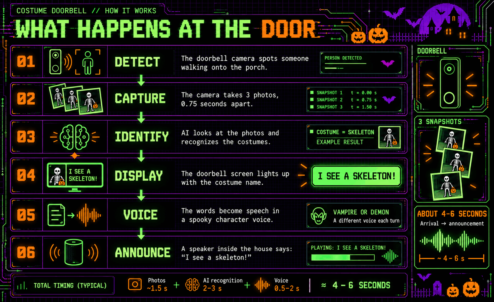
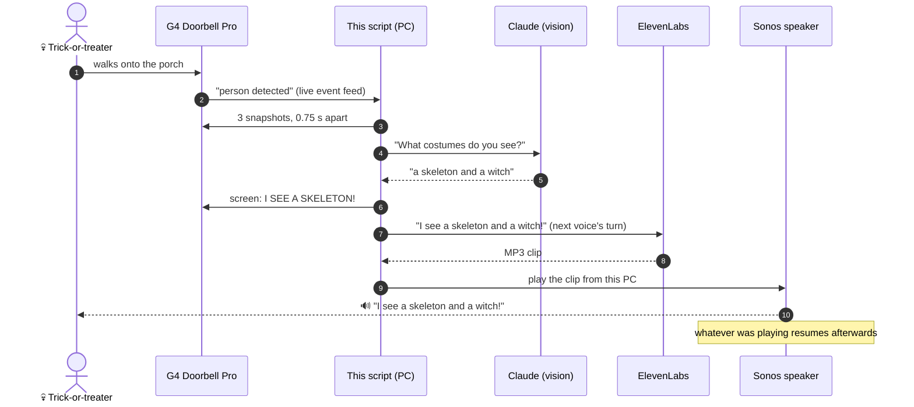
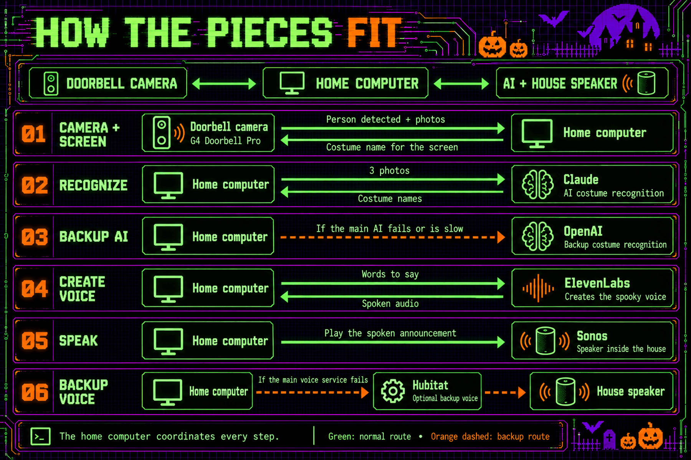
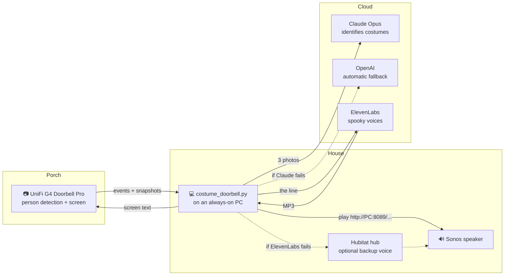
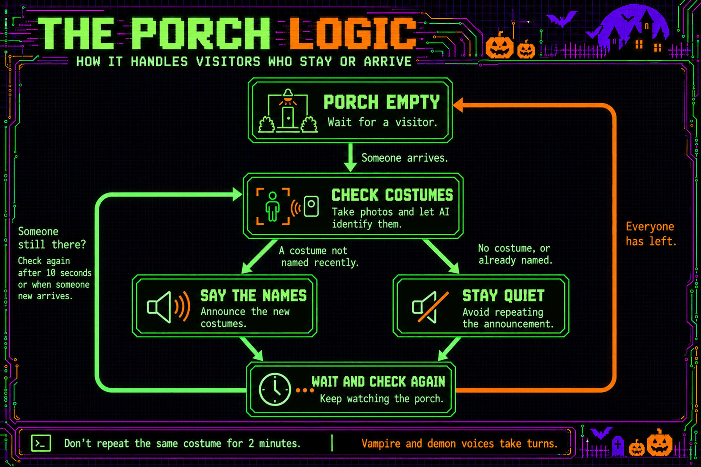
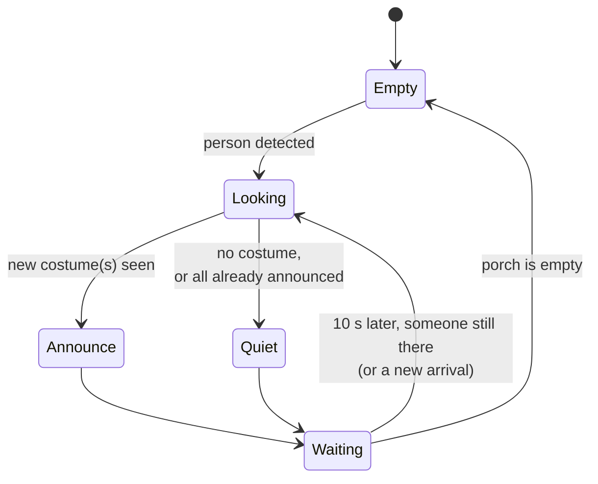

# 🎃 Costume Doorbell

**A Halloween doorbell that recognizes trick-or-treaters' costumes and calls them out by name.**



A skeleton climbs the porch steps. Before it can knock, a vampire countess's voice from inside
the house purrs *"I see a skeleton!"*, and the doorbell's screen lights up with
**I SEE A SKELETON!** Press the button and the doorbell cackles at you, and a demon laughs back
from somewhere inside.

No buttons to press, no app to open: it watches the porch, looks at the costumes, and talks.

*Questions? [Contact the Admiralty](https://www.admiralsyn-ackbar.com/contact-the-admiralty/).*

---

## What happens at the door

The graphic at the top shows the six steps.

<details>
<summary>Step-by-step diagram (text version)</summary>



</details>

From the moment the doorbell reports a person to the voice starting takes **about 4–6 seconds**:
~1.5 s for the three photos, 2–3 s for Claude, 0.5–2 s for the voice.

---

## How the pieces fit



<details>
<summary>Text version</summary>



</details>

| Piece | Job | Why it's there |
|---|---|---|
| **UniFi Protect + G4 Doorbell Pro** | Spots people, takes snapshots, shows text on its screen | Protect's API has a live event feed and a snapshot endpoint, so no extra sensors are needed |
| **Claude Opus** (low effort) | Looks at 3 photos and names the costumes | Best accuracy in dim porch light in our tests; about 2–3 s per look |
| **OpenAI** | Takes over automatically if Claude errors or is slow | A spare brain for the one night a year it matters |
| **ElevenLabs** | Turns "I see …!" into a character voice | Two library voices take turns: **Ilinca** (vampire countess) and **Malyx** (demon) |
| **Sonos** | Plays the clip | The PC serves the clip on the LAN; the speaker fetches it and resumes its music afterwards |
| **Hubitat** (optional) | Backup voice | If ElevenLabs is down, Hubitat's built-in voice (Ruth) speaks the line instead |

---

## The porch logic

Trick-or-treaters arrive in waves, linger, chat at the door, and get joined by more trick-or-treaters.
The script handles that with one simple rule: **while anyone is on the porch, look again every
10 seconds, and only announce costumes it hasn't announced recently.**



<details>
<summary>Text version</summary>



</details>

| Situation | What you hear |
|---|---|
| One witch | "I see a witch!" |
| A pirate and a cat | "I see a pirate and a cat!" |
| A group of five | "I see a mummy, a zombie and friends!" (at most 2 names) |
| Costume it can't name | "I see a trick or treater!" |
| Parent in jeans | Nothing: no costume, no announcement |
| The witch is still chatting 30 s later | Nothing: already announced (for 2 minutes) |
| A vampire joins the witch | "I see a vampire!" (only the new one) |

The two voices alternate per announcement, so one group gets Ilinca and the next gets Malyx.

---

## The button

The doorbell's own **voice recording** (set in the Protect app) replaces its ring sound with
Ilinca's whispered *"Welcome…"* and cackle. When the script sees the button press, it waits 4
seconds and has **Malyx** laugh back on the Sonos, so the two take turns instead of talking over
each other. Button-mashers get one laugh, not ten.

---

## What you need

- **UniFi Protect** with a **G4 Doorbell Pro** (other Protect doorbells should work) and a Protect API key
- **Sonos** speaker(s) on the same network
- An **Anthropic** API key (an **OpenAI** key is optional, for the fallback)
- An **ElevenLabs** account: Creator plan or higher to use library voices
- Optional: a **Hubitat** hub with the Maker API app, for the backup voice
- A PC with **Python 3.12+** that stays awake all evening

## Setup

```bash
git clone <this repo>
cd costume-doorbell
pip install -r requirements.txt
cp .env.example .env            # fill in your keys and IP addresses
python costume_doorbell.py --list-cameras    # check it can see your doorbell
python costume_doorbell.py
```

On startup it prints what it's using, something like:

```
Voices: ilinca, malyx (taking turns)
Button press plays: laugh-malyx-b.mp3  (test: curl.exe http://localhost:8088/press)
Visit log: off (nothing is saved)
Watching the doorbell for people
```

**Firewall:** the Sonos must be able to reach this PC on **TCP 8089** (`AUDIO_PORT`), because
that's where they fetch each clip.

## Try it without a trick-or-treater

| Command | What it does |
|---|---|
| `python costume_doorbell.py --test-image photo.jpg` | Identify a saved photo and print the line |
| `python costume_doorbell.py --test-image a.jpg b.jpg c.jpg` | Same, as one 3-photo burst |
| `python costume_doorbell.py --test-camera` | Snapshot the doorbell right now and identify it |
| `python costume_doorbell.py --say "I see a witch!" --voice malyx` | Speak a line on the Sonos |
| `python costume_doorbell.py --say "I see a witch!" --save-clip witch.mp3` | Save the clip instead of playing it |
| `curl http://localhost:8088/ring` | Pretend someone walked up |
| `curl http://localhost:8088/press` | Pretend the button was pressed |

Set `DRY_RUN=1` to print what it would say without making a sound.

## Settings

Everything lives in `.env`. See [`.env.example`](.env.example) for the full list with comments.
The ones you'll most likely touch:

| Setting | Default | What it does |
|---|---|---|
| `VOICES` | `ilinca,malyx` | Which voices take turns, in order |
| `SPEAK_VOLUME` | speaker's current volume | Volume for announcements, e.g. `60` |
| `RECHECK_SEC` | `10` | How often to look again while someone's on the porch |
| `REPEAT_WINDOW_SEC` | `120` | How long before the same costume can be announced again |
| `RING_SOUND` / `RING_DELAY_SEC` | `laugh-malyx-b.mp3` / `4` | The laugh on a button press, and how long it waits |
| `LCD_SECONDS` | `15` | How long the doorbell screen shows the costume (`0` = off) |
| `LOG_VISITS` | off | `text`, `images`, `audio`, a mix like `text,audio`, or `all` |

## Privacy

**Photos are kept in memory only** and never written to disk.
The visit log is off by default; turn it on with `LOG_VISITS` (for example `text,audio` keeps the
results and the spoken clips, but no photos). Your `.env` holds your API keys and is in
`.gitignore`, so it never gets committed.

## Cost

Claude Opus 5.5 costs $4 per million input tokens and $20 per million output tokens.

| | Claude cost |
|---|---|
| **One look** (3 photos ≈ 8,500 input tokens + a short answer) | about **$0.035–0.04** |
| **A busy night** (150 groups, 2–3 looks each while they're at the door) | about **$10–20** |
| **Worst case** (someone loitering for 3 hours, a look every 10 s ≈ 1,080 looks) | about **$40** |

ElevenLabs uses about 30 characters of credit per announcement, so even 150 announcements is
under 5,000 characters.

**Have a Claude Max plan?** It includes monthly API credits: **$100/month on Max 5x, $200 on
Max 20x**. Claim them by linking a Claude Console organization in claude.ai's billing settings.
They pay for this script's API calls, but they expire at the end of each billing cycle (no
rollover) and aren't included with Pro. See
[API credits for Max and Team plans](https://platform.claude.com/docs/en/about-claude/api-credits-for-subscribers).

## Troubleshooting

| Symptom | Likely cause |
|---|---|
| Robotic voice instead of Ilinca/Malyx | ElevenLabs failed (check the console) or the script wasn't restarted after a change |
| No sound at all | The Sonos can't reach the PC on TCP 8089, or the speaker is asleep/out of battery |
| Announces the parent | The model sometimes counts a festive adult as a costume; it's Halloween, let it ride |
| Misses costumes at night | Turn the porch light up: dim, side-lit, blurry frames are the main cause of misses |

## Questions?

Visited the doorbell and want to know more, or building your own? Send a message through
[**Contact the Admiralty**](https://www.admiralsyn-ackbar.com/contact-the-admiralty/).
